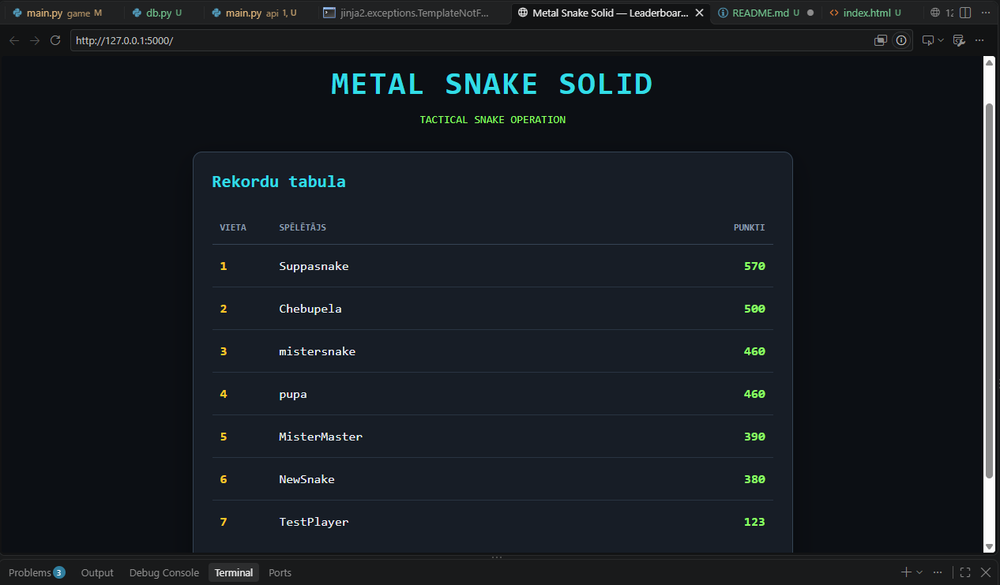

**Metal Snake Solid**
**Par spēli**
Metal Snake Solid ir Python valodā izstrādāta 2D spēle, kuras pamatā ir Snake žanrs. Spēle ir veidota, izmantojot Pygame. Spēlētājs vada čūsku, vāc augļus un bonusus, iegūst punktus un cenšas izvairīties no sadursmēm ar sienām un sevi. Spēle izmanto Flask REST API serveri un SQLite datubāzi rezultātu saglabāšanai. Labākos rezultātus var apskatīt tīmekļa pārlūkprogrammā.

**Izmantotās tehnoloģijas**
Python 3.13.15
Pygame - spēles izveidei
Flask - REST API serverim un tīmekļa lapām
Requests - spēles saziņai ar serveri
SQLite - rezultātu glabāšanai
HTML un CSS - tīmekļa lapas izveidei
Git un GitHub - versiju kontrolei

**Spēles mehānikas**

1. Ātruma bonuss. Dažreiz uz laukuma parādās īpašs auglis. Kad čuska to apēd, tās ātrums uz 5 sekundēm palielinās. Pēc tam ātrums atgriežas normālā līmenī.
2. Siena un punktu bonuss. Ik pa laikam uz laukuma parādās siena un bonuss. Ja čuska savāc bonusu, spēlētājs saņem papildu punktus. Ja čuska ietriecas sienā, spēle beidzas.

**Instalēšana**

1. Lejupielādē vai klonē projekta repozitoriju
2. Atver projekta mapi terminālī
3. Izveido virtuālo vidi:

python -m venv .venv

4. Aktivizē virtuālo vidi:

.\\.venv\Scripts\Activate.ps1

5. Instalē nepieciešamās bibliotēkas:

python -m pip install -r requirements.txt

**Kā palaist projektu**

1. Palaid serveri
   Atver pirmo termināli projekta mapē un izpildi:

python -m api.main

Serveris būs pieejams adresē:

http://127.0.0.1:5000/

Atstāj šo termināli atvērtu.

2. Palaid spēli
   Atver otru termināli projekta mapē, aktivizē virtuālo vidi un izpildi:

python game/main.py

Spēles rezultāts pēc spēles beigām tiek nosūtīts serverim ar HTTP POST pieprasījumu.

Ja serveris nav pieejams, spēle turpina darboties, bet rezultātu var neizdoties saglabāt.

REST API adreses

Metode:	   Adrese:	                               Apraksts:
POST	   /scores	                               Saglabā spēlētāja vārdu un punktus
GET	           /scores/top	                       Atgriež 10 labākos rezultātus JSON formātā
GET	           /players/{name}/stats	       Atgriež spēlētāja spēļu skaitu un labāko rezultātu

**Piemērs: rezultāta saglabāšana**
Pieprasījuma adrese: POST http://127.0.0.1:5000/scores

JSON dati:

json
{
  "player_name": "TestPlayer",
  "score": 123
}
Veiksmīgas saglabāšanas gadījumā serveris atgriež HTTP statusa kodu 201.

Ja ievaddati nav derīgi, serveris atgriež 400. Ja spēlētāja statistika nav atrasta, tiek atgriezts 404.

**Tīmekļa lapas un datubāze**
Līderu tabula: http://127.0.0.1:5000/
Top 10 rezultāti JSON formātā: http://127.0.0.1:5000/scores/top
Spēlētāja statistika: http://127.0.0.1:5000/players/TestPlayer/stats

Rezultāti tiek glabāti SQLite datubāzē records.db, kas atrodas projekta saknes mapē.

**Ekrānuzņēmums**

